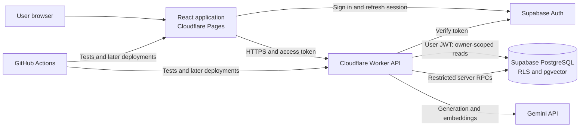

# AdaptiveAI architecture

Status: production architecture designed in Step 1; local mock chat implemented in Step 2. The frontend, demo chat API, runtime validation, provider boundary, cancellation, and retry flow now work locally. Authentication, persistence, Gemini, retrieval, feedback, and evaluation below remain planned.

## Current implementation boundary

Step 2 sends one message through `React → typed API client → POST /api/v1/demo/chat → mock provider`. The demo route returns deterministic text and exists only when `DEMO_ENABLED` is the literal string `true`. It accepts no identity, system prompt, model override, or arbitrary transcript. No provider credentials are used. Conversations are held in React state for the current tab and disappear on refresh.

The mock route deliberately does not implement the future authenticated conversation routes. Its client request ID correlates retries and stable mock responses; it is not a durable idempotency guarantee. Cancellation stops the browser fetch and prevents stale responses from changing the conversation. It does not imply that a future external provider can always undo work already accepted. The implemented flow and UI decisions are explained in [step-2.md](step-2.md).

The committed Worker configuration disables the demo. The local development command explicitly opts in, so a default Worker deployment does not accidentally publish the unauthenticated fixture. A public scripted demo would require an intentional configuration change and exact frontend origin.

## Current module boundaries

| Module | Owns | Does not own |
| --- | --- | --- |
| `apps/web/src/App.tsx` | Application composition. | Request handling or conversation state. |
| `apps/web/src/features/chat/ChatWorkspace.tsx` and `components/` | Chat presentation, composer focus, and history dialog. | HTTP parsing or provider selection. |
| `apps/web/src/features/chat/useChat.ts` and `model.ts` | Temporary conversations, turn states, retries, and active-request identity. | Durable storage or authentication. |
| `apps/web/src/features/chat/api.ts` | Browser transport, deadlines, response validation, and safe errors. | Secrets or direct provider access. |
| `apps/web/src/components/` | Reusable icons and the decorative orb. | Chat state or networking. |
| `apps/api/src/index.ts` and `app.ts` | Worker entry point, routing, methods, and the HTTP error boundary. | Model implementation or browser UI. |
| `apps/api/src/config.ts` and `http.ts` | Parsed configuration, CORS, common response headers, and bounded JSON reading. | Chat-specific reply generation. |
| `apps/api/src/routes.ts` | Health and mock-chat request orchestration. | A live AI endpoint or a database session. |
| `apps/api/src/providers/` | Provider contract and deterministic mock implementation. | HTTP response construction. |
| `packages/shared/src/` | Framework-independent API envelopes, demo contracts, and runtime validation. | React, Worker bindings, credentials, or environment access. |

Imports follow these directions:

```text
web: App → chat workspace → UI components / state hook → API client
api: Worker entry → request dispatcher → route handlers → provider
                         ↓                    ↓
                   HTTP utilities       configuration

web ──→ @adaptiveai/shared ←── api
```

The browser and Worker never import each other's source. Both use the shared package's public entry point, `index.ts`, which exports `api.ts` and `demo-chat.ts`. Shared source imports only other shared source; contracts cannot pull browser or server implementation into the opposite bundle. `tests/architecture.test.ts` checks these import boundaries with the installed TypeScript compiler. It scans production TypeScript imports, re-exports, and literal dynamic imports; this is a dependency guard, not a security sandbox.

Keep a small number of modules with clear responsibilities. Authentication, persistence, and a real provider can add explicit boundaries when implemented; placeholder services and repositories would add indirection without behavior to verify today.

## What we are building

AdaptiveAI is a hosted assistant that remembers useful, approved information for each user. Its model weights do not change. Improvement comes from retrieving relevant memory before generating an answer, then measuring whether that context helps on a fixed evaluation set.

Conversation history and long-term memory have different jobs. History preserves what was said. Memory contains selected, validated information that may help in a different conversation. Automatically treating every message as knowledge would preserve mistakes and malicious instructions.

## System boundaries



| Component | Responsibility | Why it belongs here |
| --- | --- | --- |
| React + TypeScript + Tailwind | Chat, history, memory controls, feedback, dashboard | A static SPA is simple to host; TypeScript shares API contracts. |
| Cloudflare Pages | Serve compiled frontend assets | Visitors download the app from Cloudflare rather than a laptop. |
| Cloudflare Worker | Verify requests, control quotas, orchestrate database and Gemini calls | Secrets and trusted decisions stay outside the browser. |
| Supabase Auth | Identity, OAuth, session issuance | Avoid implementing password storage or token issuance. |
| PostgreSQL + pgvector | Durable records, ownership constraints, vector search | One database keeps retrieval, provenance, and permissions together. |
| Gemini provider adapter | Generate text and embeddings | Configuration isolates model changes from application logic. |
| GitHub Actions | Repeatable verification; deployment in Step 3 | The same checks run independently of a developer's machine. |

No permanently running local server is required after deployment. Pages, Workers, Supabase, and Gemini handle traffic in the cloud. This is a production-style portfolio application, not an uptime guarantee: the [Supabase free plan can pause after inactivity](https://supabase.com/pricing), and upstream quotas can stop AI requests.

## Planned production request lifecycle

The first implementation uses a normal JSON response. Streaming can follow once persistence, cancellation, and partial-answer behavior are reliable.

1. The browser obtains a Supabase session. GitHub OAuth is the initial sign-in choice; email sign-in requires a suitable SMTP configuration because [Supabase's default mail service is restricted](https://supabase.com/docs/guides/auth/auth-smtp).
2. The Worker verifies the access token's signature, issuer, audience, and expiry using a maintained verifier. The verified subject determines the owner. A decoded JWT or browser-supplied `user_id` is not authentication. See [Supabase token verification](https://supabase.com/docs/reference/javascript/auth-getclaims).
3. It validates the JSON body, verifies conversation ownership, and atomically claims an idempotency key and usage reservation. Reusing the key with a different payload is an error. Per-user and application-wide budgets protect the shared Gemini quota.
4. It loads a bounded history window using the user's JWT, embeds the current question, and retrieves only that user's active memories in the matching embedding space. RLS remains in force during normal reads.
5. It builds a prompt from versioned application instructions, bounded history, and clearly marked retrieved data. Retrieved text is untrusted evidence, never permission to change instructions or call tools.
6. It calls Gemini with an output cap and deadline. No database transaction stays open while an external request runs.
7. It atomically saves the completed answer, provenance, usage, and request state through a restricted server write path, then returns persisted message IDs. A failure is recorded as a failure, not an empty successful answer.

An idempotency key prevents duplicate application writes and reservations; it cannot guarantee exactly-once generation at an external provider. If the Worker loses contact after a provider request, it marks the result uncertain. Stale operations need a bounded reconciliation path; they must not silently regenerate on every browser retry. Critical work cannot depend on an in-memory task surviving an isolate shutdown.

## Ownership and trusted writes

All user data starts private. The browser may contact Supabase Auth directly; application data flows through the Worker. Database policies and grants must still withstand direct requests to Supabase's public REST endpoint.

- Ordinary history and retrieval queries forward the verified user JWT. Every exposed user table has RLS, and related rows use composite tenant foreign keys.
- RLS ownership alone does not stop an owner from forging an assistant message or setting their own correction to approved. Table and column grants must deny those direct mutations.
- Canonical messages, validation decisions, memory activation, quota reservations, and evaluation results use narrowly scoped server-only RPCs. Ordinary users cannot execute those functions.
- A privileged Supabase server key bypasses RLS. The Worker-only functions therefore perform explicit ownership, relationship, state-transition, and authorization checks. Keep their search path fixed and revoke default public execution. A server key is not a substitute for these checks.
- No endpoint accepts a tenant override. Operator privileges come from server-managed authorization, never editable user metadata.

The detailed table, grant, and foreign-key design is in [database.md](database.md). These protections remain design requirements; the mock chat milestone does not claim to have implemented or tested them. See [Supabase RLS](https://supabase.com/docs/guides/database/postgres/row-level-security) and [database security](https://supabase.com/docs/guides/database/secure-data).

## Memory and validation

The learning loop is: **submit feedback → validate → approve → embed → activate → retrieve → evaluate**. Rejected or incomplete records never enter retrieval.

Personal preferences can be confirmed by their owner after content checks. A factual correction requires supporting evidence and an authorized review; model agreement alone does not establish truth. First-version factual review can be manual. Approval and embedding completion are distinct: only an approved revision with a valid embedding becomes active.

Memories retain source feedback/message IDs, revision, reviewer decision, and embedding configuration. Edits create a new revision; an old embedding cannot describe revised text. Deletion or revocation removes a memory from retrieval immediately and removes its derived embedding. Conversation deletion also deletes or invalidates memories derived from its messages according to [the deletion contract](database.md).

Start with text embeddings of **768 dimensions**, cosine similarity, and exact search within the owner's active records. The proposed model is `gemini-embedding-001`, subject to availability and free-tier verification at integration time. Normalize its reduced-dimension output; Google's [embedding documentation](https://ai.google.dev/gemini-api/docs/embeddings) describes this requirement. Store the model, dimensionality, task configuration, and pipeline version. Never compare vectors produced by incompatible embedding configurations. Add an HNSW index only after real query volume and latency justify it; changing models requires re-embedding and an explicit cutover.

## Reliability, budgets, and privacy

Cloudflare burst limits are useful abuse controls, but their [rate-limit binding is approximate and location-specific](https://developers.cloudflare.com/workers/runtime-apis/bindings/rate-limit/). An atomic PostgreSQL reservation enforces the application-wide budget. Generation, embedding, validation calls, and evaluation all consume that budget. Failed calls are accounted for conservatively when provider usage is uncertain.

The planned production Worker must limit body size, history, retrieved context, output tokens, concurrency, and retries. It must return explicit quota/unavailable states and use request IDs for diagnosis. Logs should contain operation metadata, latency, and error codes; raw prompts, responses, tokens, keys, and personal memory are excluded. Step 2 already enforces demo body limits and response correlation but has no provider quota or production logging subsystem. CORS allows configured frontend origins but is not authentication.

Only public configuration may use `VITE_*` variables. Gemini and privileged Supabase keys belong in Worker secrets. Preview deployments use separate credentials/data and exact callback/origin allowlists before integration.

The [Gemini terms](https://ai.google.dev/gemini-api/terms), checked 2026-11-16, require Paid Services when making clients available to users in the EEA, Switzerland, or UK. Unpaid-service data rules also vary by location and billing status. Step 3 must resolve the intended audience and provider configuration; this repository does not enable billing or promise a globally available zero-cost live Gemini service. Use synthetic data while developing the public demo.

## Repository and delivery boundaries

```text
apps/web/          React application; deployable static build
apps/api/          Worker entry point and API tests
packages/shared/   API types shared by browser and Worker
docs/              Architecture, API, schema, evaluation, setup
supabase/          Future migrations and database isolation tests
tests/e2e/         Playwright browser tests
.github/workflows/ Verification now; controlled deployment later
```

Use npm workspaces and one lockfile. Avoid adding separate microservices, a queue, or an ORM until a specific need appears. The Worker uses HTTPS database APIs/RPCs; migrations remain SQL so PostgreSQL permissions and constraints are explicit.

Before a public live AI endpoint, implement verified identity, secret handling, ownership checks, input limits, and durable usage budgets. Full account/history UX can follow. CI must pass type checking, Vitest, builds, and Playwright. Later database tests must prove that two users cannot access each other's rows or bypass memory approval through direct REST calls. Evaluation uses frozen comparisons described in [evaluation.md](evaluation.md); do not advertise improvement before obtaining results.
